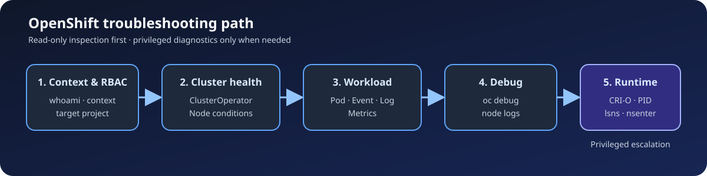

# OpenShift 운영 점검과 Template 처리 실습

Red Hat OpenShift Container Platform에서 프로젝트를 선택하고 클러스터 상태를 관찰한 뒤, Pod·노드 문제를 단계적으로 좁혀 가는 운영 학습 저장소입니다. 반복 가능한 점검 스크립트와 파라미터형 OpenShift Template 예제로 학습 범위를 재구성했습니다.

이 저장소는 **DO180 OpenShift Container Platform 4.18 학습 범위**를 기준으로 합니다. 실제 운영 경험이나 클러스터 적용 완료를 주장하지 않으며, 로컬 정적 검증과 클러스터 검증 절차를 구분합니다.

## 운영 점검 흐름



접속 대상과 권한을 확인한 뒤 ClusterOperator·Node 상태에서 이상 범위를 좁히고, Pod·Event·Metrics를 확인합니다. 일반 조회로 원인을 찾기 어려운 경우에만 `oc debug`와 CRI-O 수준 진단으로 확장합니다.

## 이 저장소가 담당하는 범위

| 저장소 | 중심 범위 |
| --- | --- |
| `docker_repo` | Dockerfile, 이미지 빌드, Registry, Compose |
| `kubernetes_repo` | 범용 Kubernetes Workload, Service, Storage, 배포 전략 |
| **이 저장소** | `oc` 기반 프로젝트·Operator·클러스터 상태 점검, 노드 디버깅, Template 처리 |

## 주요 구성

| 항목 | 구현 내용 | 파일 |
| --- | --- | --- |
| 상태 점검 자동화 | 현재 Context, ClusterOperator, 노드, Pod, 이벤트, Metrics를 읽기 전용으로 수집 | [`scripts/cluster-health-check.sh`](scripts/cluster-health-check.sh) |
| 운영 Runbook | 로그인부터 Pod·노드·CRI-O 진단까지 권한과 위험도를 구분한 점검 순서 | [`docs/operations-runbook.md`](docs/operations-runbook.md) |
| Template 예제 | 애플리케이션 이름·이미지·복제본 수를 파라미터로 받아 Deployment 정의 생성 | [`manifests/app-template.yaml`](manifests/app-template.yaml) |
| 버전 판단 기준 | 4.18 학습 내용과 4.22 공식 문서의 대응, 실행 전 확인할 API·명령 | [`docs/version-compatibility.md`](docs/version-compatibility.md) |

## 저장소 구조

```text
.
├── docs/
│   ├── operations-runbook.md
│   ├── images/
│   │   └── operations-flow.svg
│   └── version-compatibility.md
├── manifests/
│   └── app-template.yaml
├── scripts/
│   └── cluster-health-check.sh
└── tests/
    └── run-tests.sh
```

## 빠른 시작

`oc`가 설치되어 있고 실습 클러스터에 로그인한 상태에서 실행합니다. 스크립트는 리소스를 생성·변경·삭제하지 않습니다.

```bash
git clone https://github.com/tjung03/OpenShift.git
cd OpenShift

./scripts/cluster-health-check.sh --help
./scripts/cluster-health-check.sh --namespace <project-name>
```

ClusterOperator와 노드를 포함한 클러스터 범위 조회에는 추가 RBAC 권한이 필요합니다. 권한 또는 Metrics API 부족으로 일부 명령이 실패해도 나머지 점검은 계속되며, 마지막에 실패 항목 수를 반환합니다.

## Template 확인과 적용

먼저 파라미터와 렌더링 결과를 확인합니다. `<image-reference>`에는 대상 클러스터에서 접근하고 실행할 수 있는 이미지를 지정합니다. `APP_NAME`은 Kubernetes 리소스 이름에 사용할 수 있는 DNS label 형식이어야 합니다.

```bash
oc process -f manifests/app-template.yaml --parameters

oc process -f manifests/app-template.yaml \
  -p APP_NAME=portfolio-web \
  -p IMAGE=<image-reference> \
  -p REPLICAS=2 \
  | oc apply --dry-run=server -f -
```

서버 측 검증 결과가 정상일 때만 실제 리소스를 생성합니다. `oc new-project`는 ProjectRequest 생성 권한이 허용된 환경에서만 실행합니다. 자체 프로젝트 생성이 제한되어 있다면 관리자가 승인한 기존 프로젝트를 `oc project <project-name>`으로 선택합니다.

```bash
oc auth can-i create projectrequests.project.openshift.io
oc new-project portfolio-openshift

oc process -f manifests/app-template.yaml \
  -p APP_NAME=portfolio-web \
  -p IMAGE=<image-reference> \
  -p REPLICAS=2 \
  | oc apply -f -

oc rollout status deployment/portfolio-web --timeout=120s
oc get deployment,pod
```

실습을 마치면 현재 프로젝트를 다시 확인하고, 이 예제에 해당하는 리소스만 삭제합니다.

```bash
oc project
oc delete deployment -l app.kubernetes.io/instance=portfolio-web
```

## 검증 범위

```bash
./tests/run-tests.sh
```

로컬 검증은 Bash 문법, CLI 옵션 처리, mock `oc`를 사용한 정상·부분 실패 흐름, Template의 YAML 구문과 파라미터 구성을 확인합니다. 실제 OpenShift 클러스터의 API·RBAC·Admission 정책·이미지 실행 가능성은 연결된 클러스터에서 `oc apply --dry-run=server`와 실행 상태로 추가 검증해야 합니다.

## 버전과 현재 활용 방식

- 기준 자료는 OpenShift Container Platform **4.18**이며, 4.14 자료는 차이 확인에만 사용했습니다.
- `oc debug`, `oc adm top`, `template.openshift.io/v1`은 **2026-09-28 검토 시점의 4.22 공식 문서**에서도 확인되는 방식입니다.
- 실행 전 `oc version`, `oc api-resources`, `oc explain`으로 대상 클러스터가 제공하는 API와 필드를 확인합니다.
- 학습용 부동 이미지 태그를 그대로 고정하지 않았습니다. 실제 환경에서는 검증한 image digest 또는 내부 ImageStream 정책을 사용합니다.

자세한 판단 근거와 교정 내용은 [버전 및 호환성 문서](docs/version-compatibility.md)를 참고합니다.

## 참고 문서

- [OpenShift Container Platform 4.18 문서](https://docs.redhat.com/en/documentation/openshift_container_platform/4.18/)
- [OpenShift Container Platform 최신 문서](https://docs.redhat.com/en/documentation/openshift_container_platform/)
- [OpenShift CLI (`oc`) 문서](https://docs.redhat.com/en/documentation/openshift_container_platform/4.18/html/cli_tools/openshift-cli-oc)
- [OpenShift Template API](https://docs.redhat.com/en/documentation/openshift_container_platform/4.18/html/template_apis/template-template-openshift-io-v1)
